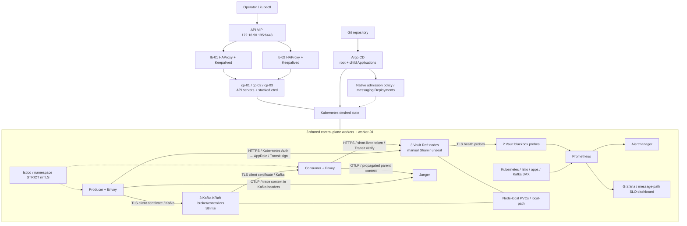

# Architecture

The VIP moves between two independent load balancers. HAProxy forwards TCP to
three API servers; three etcd members tolerate one member loss. The current lab
also uses the control-plane hosts for application scheduling. VM addresses,
network interface and API endpoint are explicit in the Ansible inventory and
templates.

The producer exposes `POST /events`, signs the event with Vault Transit and
publishes with `acks=all`. Kafka uses three combined KRaft nodes, replication
factor 3 and minimum ISR 2. The consumer verifies the signature and commits an
offset after processing or acknowledged dead-letter publication. OpenTelemetry
context is propagated in Kafka headers so producer and consumer spans share a
trace. See [delivery semantics](decisions.md#kafka-and-message-delivery).

Istio injects sidecars into the messaging namespace; its PeerAuthentication is
STRICT. Kafka additionally requires TLS client certificates at port 9094, and
Vault verifies its HTTPS server certificate. The public CA files in the messaging chart are
trust anchors; their corresponding private keys are kept outside Git.

The application uses a projected service-account JWT for Vault Kubernetes Auth,
then obtains one-use AppRole SecretIDs and 60-second runtime tokens. Separate
producer and consumer Vault policies limit KV and Transit operations. Normal producer/consumer processing calls Transit sign/verify with short-lived
runtime tokens.

Prometheus collects Kubernetes, Istio, application and Kafka exporter metrics.
Vault is monitored using certificate-validated health probes for all three pods;
this collects availability and seal-state signals. Jaeger receives spans over OTLP. Alertmanager receives consumer-lag,
mesh-degradation and Vault-availability alerts. Persistent lab data uses
node-local volumes.

The consumer records producer-to-commit latency as a Prometheus histogram.
Grafana displays the rolling 24-hour 99%-within-5s SLO together with lag and
errors. Dashboard provisioning and the messaging Deployment admission policy
are reconciled by two additional Argo CD Applications. See
[optional controls](optional-features.md) and the [incident runbook](runbook.md).
